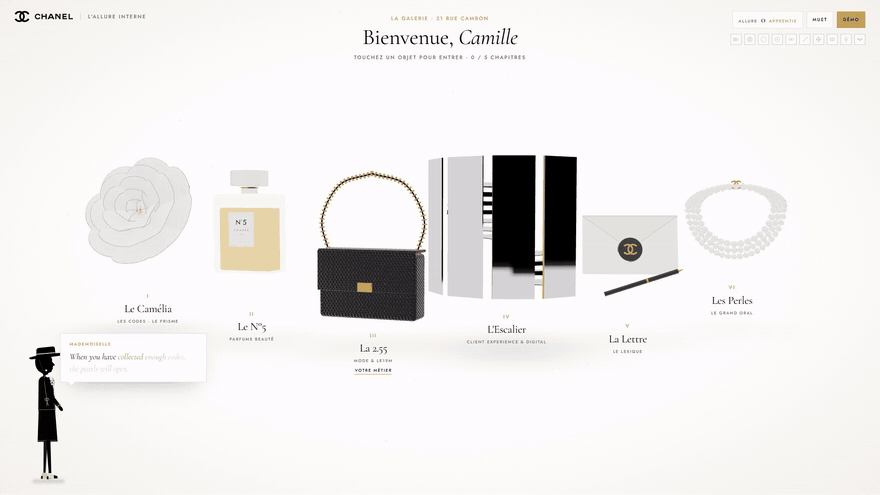
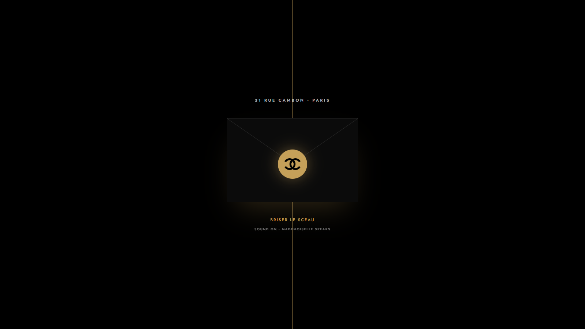
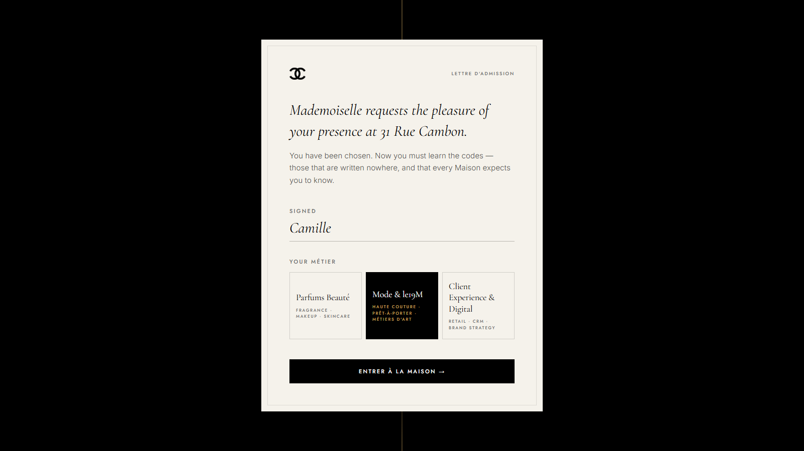
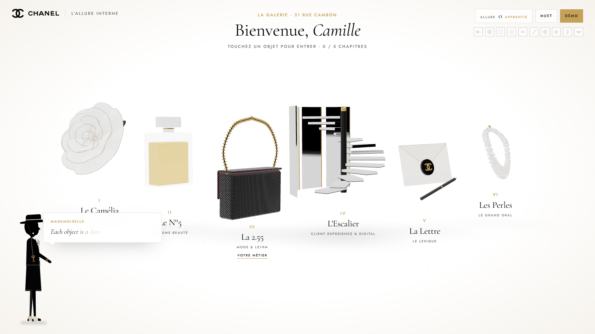
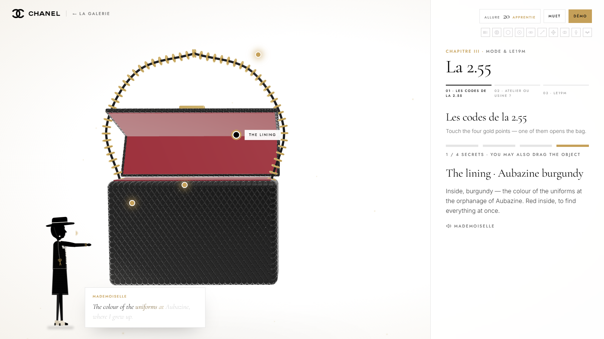
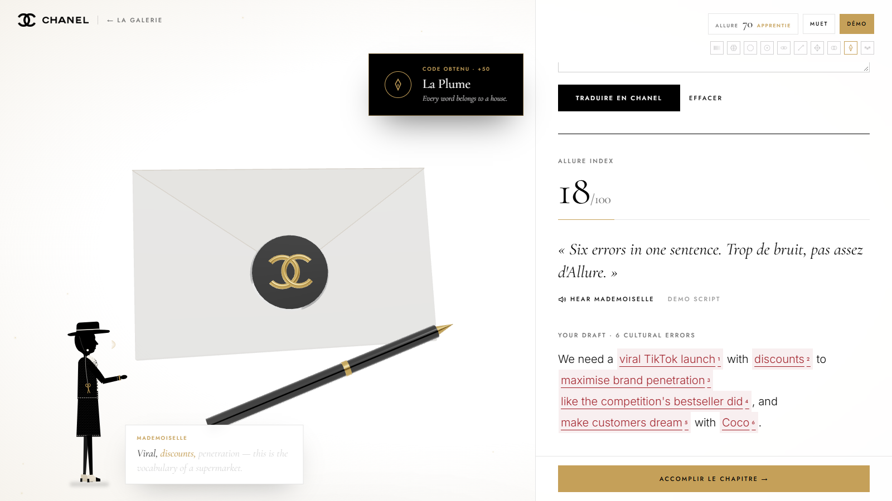
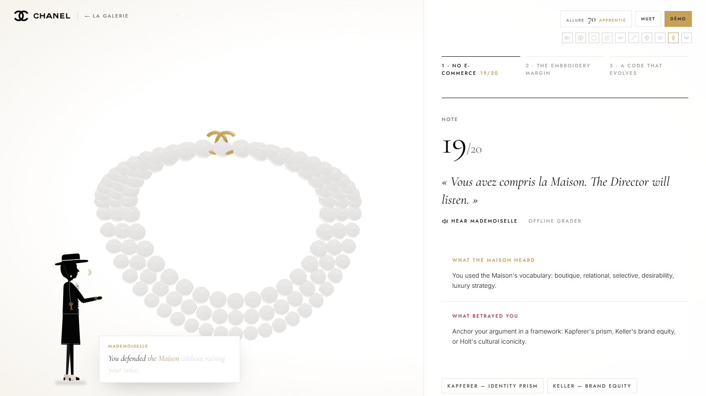
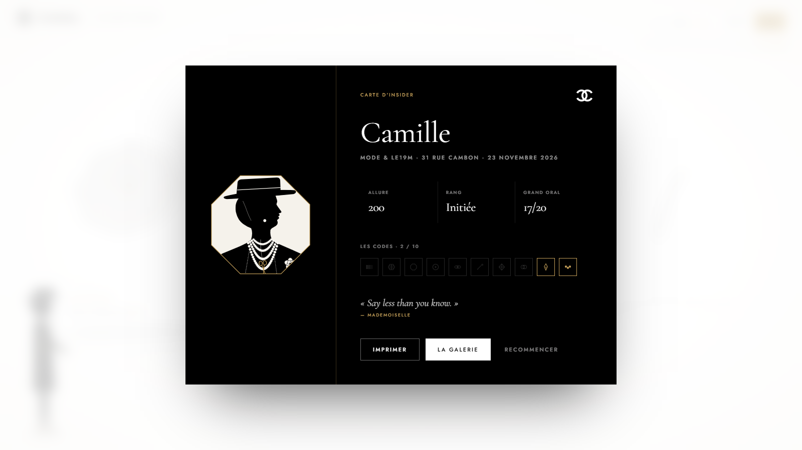

# L'Allure Interne: a voice-first onboarding that teaches new CHANEL interns the codes no one writes down

**Live:** [l-allure-interne-31-rue-cambon-digi.vercel.app](https://l-allure-interne-31-rue-cambon-digi.vercel.app) · **Film:** [64-second walkthrough](L-Allure-Interne-film.mp4) · **Role:** concept, UX/UI, conversation and voice design, build · **Context:** brief from CHANEL, *Strategic Brand Management*, HEC Paris, Oct 2026



---

## The problem

A new intern at a luxury Maison gets the facts on day one: the history, the products, the org chart. What nobody hands them is the *posture*: which words the Maison never uses, why a discount damages brand equity, why the bag's lining is burgundy. Those codes are learned slowly, by watching, and usually by getting them wrong in front of a manager.

The risk is concrete. Interns arrive fluent in mass-market marketing: "viral launch", "promotion", "maximise penetration". In a luxury house that vocabulary works against the brand. A slide deck can list the rules, but it can't make anyone *practise* them.

**Users:** interns in their first weeks, in three Métiers: *Parfums Beauté*, *Mode & le19M*, *Client Experience & Digital*.

## Design principles

1. **Learn the codes by using them, not by reading them.** Every chapter ends in something to *do*: sort, match, translate a brief, defend a decision out loud. Knowing a rule and applying it are different skills, and only the second one counts on the job.
2. **A mentor, not a manual.** The guide is Mademoiselle, a full-figure character who walks the gallery, points at what you hover, steps inside objects with you and *speaks*, with a designed voice and word-synchronised typography. Onboarding is about belonging, so it should feel like being welcomed by someone.
3. **Every fact comes from one source of truth.** Everything Mademoiselle says, written or spoken, is grounded in a single curated knowledge base built on the course frameworks (Kapferer's identity prism, Keller's brand equity, Holt's cultural iconicity, *The Luxury Strategy*). The AI can rephrase and grade, but it can't make up history.
4. **The interface is the brand.** The design system follows the Maison's own codes: black, white, beige, gold, burgundy; no rounded corners; editorial serif for voice, spaced capitals for UI. The product teaches the codes by respecting them on every screen.
5. **A live demo never fails.** The app was built to be presented in a room. If the network drops, it falls back to pre-recorded audio, offline grading engines and a silent-reading mode, so the presentation keeps going.

## The experience: *Le Parcours*

**1. An invitation, not a login.** A black envelope sealed in gold. Break the seal and a letter of admission from Mademoiselle asks you to sign and choose your Métier. The content then adapts to it.

| | |
|---|---|
|  |  |

**2. La Galerie Blanche.** The black doors of 31 Rue Cambon open onto an all-white 3D gallery of the Maison's icons: the camellia, the N°5, the 2.55, the mirrored staircase, a sealed letter, the pearls. Each object is a door to a chapter.



**3. Chapters you play.** Touch the gold points on an object to reveal its codes: the 2.55 opens on its burgundy lining, the colour of the uniforms at the Aubazine orphanage. Then play: *Abstract or figurative?*, *Atelier or factory?*, the le19M match, the five colours, Kapferer's prism, client-room situations, the KPIs you would present.



**4. The Lexicon Translator.** Paste a brief written in mass-market language. Every off-brand phrase is marked in red, numbered, and rewritten in the Maison's vocabulary, with the framework that explains why.



**5. Le Grand Oral.** Defend a real Maison decision (no e-commerce for fashion, the embroidery margin, a code that evolves) as you would to a director. Type or speak the answer; it is graded out of 20, with what the Maison heard and what gave you away.



**6. The Carte d'Insider.** Collect ten codes, earn *Allure* points and ranks (*Apprentie → Initiée → Insider → Gardienne des Codes*) and leave with a printable insider card.



## What I learned

1. **Brand strategy can be a product spec.** The course frameworks became concrete rules: a forbidden-words list, a grading rubric, a colour palette, a rule never to say "Coco". Turning theory into constraints a system enforces was the most useful exercise of the project.
2. **For tacit knowledge, the format is the message.** A gamified 3D gallery could look like decoration. Here it does the teaching: an intern who has *opened* the 2.55 remembers why the lining is burgundy.
3. **Design for the room you'll present in.** Pre-cached audio, offline engines and a presenter mode (every door open, instant answers) cost a few days. They are the reason the demo can run on any laptop and any Wi-Fi.

> *Independent prototype. Not an official CHANEL product. CHANEL and its logos are trademarks of CHANEL.*

---

<details>
<summary><strong>Tech notes</strong></summary>

### Stack

Next.js 16 (App Router), React 19, Tailwind CSS v4, Framer Motion, react-three-fiber + drei for the 3D gallery, zustand for progress. Claude (Anthropic API) is Mademoiselle's mind; ElevenLabs gives her a designed voice (TTS with timestamps) and transcribes spoken answers (Scribe).

### Architecture

- **Knowledge base (RAG):** `knowledge/chanel_rag_knowledge_base.md` is compiled into `lib/knowledge/kb.generated.ts` and injected into Mademoiselle's system prompt (prompt-cached). Each Métier adds a context block to the request.
- **Claude:** structured outputs (Zod schemas) for the translator and the grader, so errors can be highlighted precisely inside the original text.
- **ElevenLabs:** TTS *with timestamps* drives word-level kinetic typography; a Web Audio analyser drives the ink waves; Scribe transcribes spoken answers. API keys never leave the server.
- **Sound design:** the ambient salon pad, harp notes and bells are synthesised live in Web Audio. There are no audio files.
- **Resilience:** pre-cached demo audio, offline engines (rule-based lexicon, heuristic grader) and a silent-reading mode keep a live demo running if the network fails.
- **Presenter mode:** **Démo** (Shift+D) opens every door and serves answers instantly; `/?galerie` skips the prologue.
- **Film:** `scripts/film/` records the live site shot by shot with Playwright and assembles the walkthrough film.

### Run it

```bash
npm install
cp .env.example .env.local   # then fill in the keys
npm run dev                  # http://localhost:3000
```

| Variable | Purpose |
|---|---|
| `ANTHROPIC_API_KEY` | Claude: Mademoiselle's mind |
| `ELEVENLABS_API_KEY` | Voice (TTS) and transcription (Scribe) |
| `ELEVENLABS_VOICE_ID` | Mademoiselle's voice, created with the steps below |

Without keys the app still works: the voice falls back to silent reading with the same kinetic typography, and the Lexicon and Grand Oral use offline engines grounded in the knowledge base.

### Mademoiselle's voice (ElevenLabs Voice Design)

```bash
npm run voice:design             # 3 previews in ./voice-previews: listen and choose
npm run voice:save -- <generated_voice_id>
npm run demo:precache            # pre-generates audio for every authored line
```

Development agents and skills for Claude Code live in `.claude/` (see `CLAUDE.md`).

</details>
